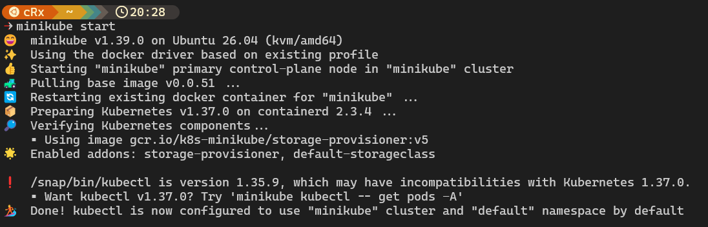
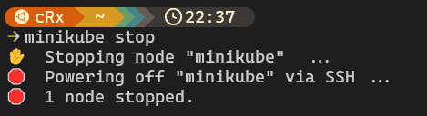

# 🚀 Levantar un clúster de Kubernetes para labs

Una guía de como levantar un clúster de Kubernetes en local usando minikube para poder realizar pruebas o ejercicios

---

## 📌 Tabla de Contenidos
1. [Requisitos Previos](#-requisitos-previos)
2. [Paso 1: Instalación Minikube](#paso-1-instalación-minikube)
3. [Paso 2: Iniciar y detener Minikube](#paso-2-iniciar-y-detener-minikube)
4. [Comandos Esenciales K8s](#comandos-esenciales-k8s)

---

## 🛠 Requisitos Previos

Antes de empezar, asegúrate de tener instalado:
*   [Docker.io](https://www.docker.com/) Necesario para levantar el clúster con minikube

---

## Paso 1: Instalación Minikube

Revisa la documentación de [Minikube](https://minikube.sigs.k8s.io/docs/)

Para la instalación en Linux x86-64:

```bash
curl -LO https://github.com/kubernetes/minikube/releases/latest/download/minikube-linux-amd64
sudo install minikube-linux-amd64 /usr/local/bin/minikube && rm minikube-linux-amd64
```

> 💡 **Nota:** Para otros sistemas operativos revisar la documentación.

---

## Paso 2: Iniciar y detener Minikube

Tras la instalación podemos iniciar el clúster:

```bash
minikube start
```



Una vez terminemos de usar el clúster lo podemos detener:

```bash
minikube stop
```


---

## Comandos Esenciales K8s

Adjunto un documento con comandos esenciales de K8s que son ideales para probar en nuestro clúster de pruebas de Kubernetes: [Guía Comandos Esenciales K8s](https://github.com/joan-camps-ciria/Proyectos-Laboratorio/tree/master/Kubernetes-Lab/guide.md)

---

<details>
<summary><b>¿Qué hago si obtengo un error al iniciar minikube con docker?</b></summary>
Probablemente tu usuario no tenga permisos para levantar contenedores con Docker, aplicar grupo al usuario con: <code>sudo usermod -aG docker $USER</code>
</details>

---

Hecho con ❤️ por [Joan Camps](https://github.com/joan-camps-ciria)

