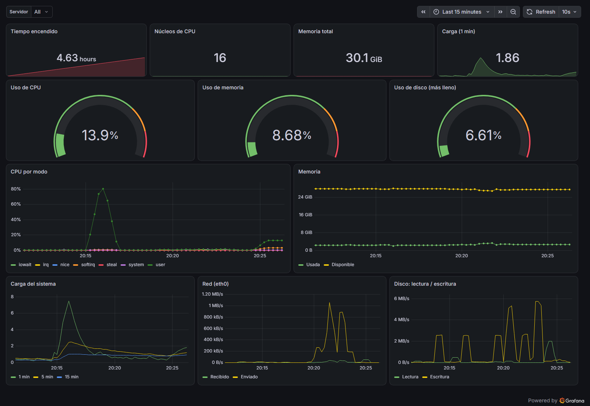
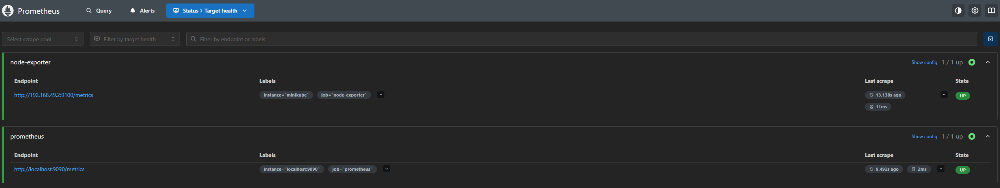
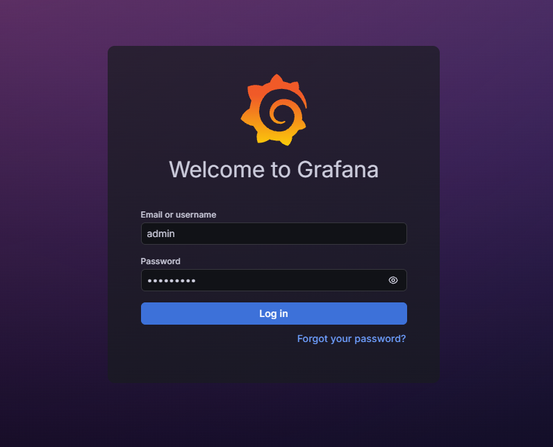
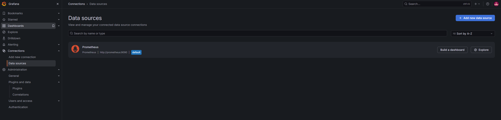
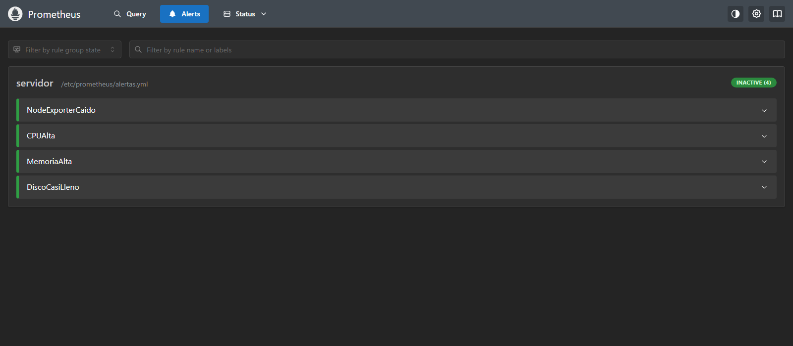
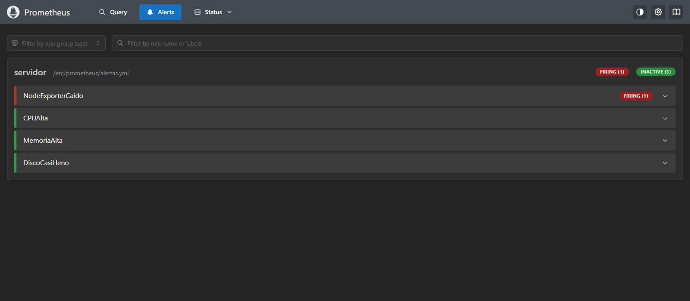

# 📊 Monitorizar un servidor con Prometheus, Grafana y node-exporter en Kubernetes

Una guía de cómo montar desde cero, **con manifiestos YAML escritos a mano**, un stack de monitorización de servidores en un clúster local de Kubernetes con minikube: node-exporter recoge las métricas del servidor (CPU, memoria, disco, red), Prometheus las almacena y evalúa alertas, y Grafana las muestra en un panel.

Sin Helm ni operadores: cada pieza está a la vista para entender cómo se conectan entre sí.



---

## 📌 Tabla de Contenidos
1. [Requisitos Previos](#-requisitos-previos)
2. [Arquitectura](#-arquitectura)
3. [Estructura del Proyecto](#-estructura-del-proyecto)
4. [Paso 1: Arrancar minikube](#paso-1-arrancar-minikube)
5. [Paso 2: Desplegar node-exporter](#paso-2-desplegar-node-exporter)
6. [Paso 3: Desplegar Prometheus](#paso-3-desplegar-prometheus)
7. [Paso 4: Consultas PromQL](#paso-4-consultas-promql)
8. [Paso 5: Desplegar Grafana](#paso-5-desplegar-grafana)
9. [Paso 6: Estresar la CPU](#paso-6-estresar-la-cpu)
10. [Paso 7: Provocar una alerta](#paso-7-provocar-una-alerta)
11. [Modificar la configuración](#-modificar-la-configuración)
12. [Limpieza](#-limpieza)

---

## 🛠 Requisitos Previos

Antes de empezar, asegúrate de tener instalado:
*   [Docker.io](https://www.docker.com/) Necesario para levantar el clúster con minikube
*   [Minikube](https://minikube.sigs.k8s.io/docs/) y [kubectl](https://kubernetes.io/docs/tasks/tools/)

> 💡 **Nota:** Si todavía no tienes minikube, sigue primero el tutorial [Levantar un clúster de Kubernetes para labs](../Kubernetes-Lab/README.md).

---

## 🧩 Arquitectura

```text
┌──────────────────────── Nodo "minikube" ────────────────────────┐
│                                                                 │
│  /proc  /sys  /   ──lee──►  node-exporter (DaemonSet, :9100)    │
│                                   ▲                             │
│                                   │ cada 15 s pide /metrics     │
│                                   │                             │
│  API de Kubernetes ◄──descubre── Prometheus (Deployment, :9090) │
│                                   ▲    └─ evalúa alertas.yml    │
│                                   │ consultas PromQL            │
│                                   │                             │
│                              Grafana (Deployment, :3000)        │
└───────────────────────────────────▲─────────────────────────────┘
                                    │ kubectl port-forward
                                Navegador
```

| Pieza | Recurso de Kubernetes | Función |
|---|---|---|
| **node-exporter** | `DaemonSet` + `Service` headless | Un pod en **cada nodo** que expone las métricas del servidor |
| **Prometheus** | `Deployment` + `ConfigMap` + RBAC | Descubre los node-exporter, guarda las métricas y evalúa las alertas |
| **Grafana** | `Deployment` + `Secret` + `ConfigMaps` | Visualiza las métricas. Datasource y panel se crean solos al arrancar (*provisioning*) |

---

## 📂 Estructura del Proyecto

```text
Monitoring-K8s-Lab/
├── k8s/
│   ├── 00-namespace.yaml      # Namespace "monitoring"
│   ├── 01-node-exporter.yaml  # DaemonSet + Service headless
│   ├── 02-prometheus.yaml     # RBAC + configuración + alertas + Deployment + Service
│   └── 03-grafana.yaml        # Secret + provisioning + Deployment + Service
├── dashboards/
│   └── servidor.json          # Panel de Grafana: CPU, memoria, disco, red, carga…
└── img/                       # Capturas de esta guía
```

> 💡 **Nota:** Todos los comandos de esta guía se ejecutan desde el directorio `Monitoring-K8s-Lab/`.

---

## Paso 1: Arrancar minikube

```bash
minikube start
```

> 💡 **Nota:** El stack completo consume alrededor de 1 GB de RAM. Si tu minikube tiene poca memoria asignada, recréalo con `minikube delete && minikube start --memory=4096`.

---

## Paso 2: Desplegar node-exporter

```bash
kubectl apply -f k8s/00-namespace.yaml -f k8s/01-node-exporter.yaml
```
*Resultado esperado:*
```text
namespace/monitoring created
daemonset.apps/node-exporter created
service/node-exporter created
```

Comprueba que el DaemonSet ha creado un pod en el nodo:

```bash
kubectl -n monitoring get daemonset,pods -o wide
```
*Resultado esperado:*
```text
NAME                           DESIRED   CURRENT   READY   UP-TO-DATE   AVAILABLE   NODE SELECTOR   AGE
daemonset.apps/node-exporter   1         1         1       1            1           <none>          21s

NAME                      READY   STATUS    RESTARTS   AGE   IP             NODE
pod/node-exporter-lwhc8   1/1     Running   0          21s   192.168.49.2   minikube
```

*   **`DESIRED 1`**: un DaemonSet quiere un pod por nodo. Con 5 nodos habría 5 pods.
*   **La IP del pod es la del nodo** (`192.168.49.2`): con `hostNetwork: true` el pod usa la red del servidor, no una IP propia del clúster. Así node-exporter ve las interfaces de red reales.

Gracias a eso, puedes leer las métricas en crudo directamente desde tu máquina:

```bash
curl -s $(minikube ip):9100/metrics | grep -E '^node_(load1|memory_MemTotal_bytes|memory_MemAvailable_bytes|boot_time_seconds) '
```
*Resultado esperado:*
```text
node_boot_time_seconds 1.793285296e+09
node_load1 0.17
node_memory_MemAvailable_bytes 3.0154682368e+10
node_memory_MemTotal_bytes 3.2270856192e+10
```

Este es el formato que lee Prometheus: **una métrica por línea con su valor**. node-exporter expone casi mil métricas distintas.

> 💡 **Nota:** Con el driver Docker, el "nodo" de minikube es un contenedor que comparte el kernel con tu máquina. Por eso node-exporter muestra **toda la RAM y CPU del equipo anfitrión** (aquí 30 GiB y 16 núcleos) y no los límites de minikube. En un servidor real, el nodo es la propia máquina y los datos corresponden exactamente a ella.

---

## Paso 3: Desplegar Prometheus

```bash
kubectl apply -f k8s/02-prometheus.yaml
```
*Resultado esperado:*
```text
serviceaccount/prometheus created
clusterrole.rbac.authorization.k8s.io/prometheus created
clusterrolebinding.rbac.authorization.k8s.io/prometheus created
configmap/prometheus-config created
deployment.apps/prometheus created
service/prometheus created
```

Los tres primeros recursos son los **permisos (RBAC)**. Prometheus pregunta a la API de Kubernetes qué pods hay detrás del Service `node-exporter`, y para eso necesita permiso de lectura:

```text
ServiceAccount "prometheus"   ← identidad con la que se ejecuta el pod
        │
ClusterRoleBinding            ← une la identidad con el rol
        │
ClusterRole "prometheus"      ← solo get/list/watch de pods, services, nodes y endpointslices
```

El descubrimiento automático se configura en el `ConfigMap`:

```yaml
- job_name: node-exporter
  kubernetes_sd_configs:
    - role: endpointslice          # pregunta a la API por los endpoints de los Services
  relabel_configs:
    - source_labels: [__meta_kubernetes_service_name]
      regex: node-exporter
      action: keep                 # se queda solo con los del Service node-exporter
    - source_labels: [__meta_kubernetes_pod_node_name]
      target_label: instance       # muestra el nombre del nodo en vez de la IP
```

Si mañana se añade un nodo al clúster, el DaemonSet crea un pod nuevo y Prometheus lo empieza a monitorizar solo, sin tocar la configuración.

Espera a que el pod esté `Running`:

```bash
kubectl -n monitoring get pods
```
*Resultado esperado:*
```text
NAME                          READY   STATUS    RESTARTS   AGE
node-exporter-lwhc8           1/1     Running   0          4m17s
prometheus-6c9c7bbdbf-ftbrh   1/1     Running   0          38s
```

En **otra terminal**, abre un túnel hacia Prometheus y déjalo abierto:

```bash
kubectl -n monitoring port-forward svc/prometheus 9090:9090
```

Abre **http://localhost:9090/targets**. Los dos *targets* deben aparecer en estado **UP**:



| Job | Endpoint | Cómo se encontró |
|---|---|---|
| `node-exporter` | `192.168.49.2:9100` | **Descubierto automáticamente** a través de la API de Kubernetes (`instance="minikube"`) |
| `prometheus` | `localhost:9090` | Configurado a mano (`static_configs`): Prometheus se monitoriza a sí mismo |

---

## Paso 4: Consultas PromQL

En **http://localhost:9090/query** prueba estas consultas (botón *Execute*, pestaña *Graph*):

| Consulta | Qué muestra |
|---|---|
| `up` | 1 si el target responde, 0 si no |
| `100 * (1 - avg(rate(node_cpu_seconds_total{mode="idle"}[1m])))` | Uso de CPU en % |
| `100 * (1 - node_memory_MemAvailable_bytes / node_memory_MemTotal_bytes)` | Uso de memoria en % |
| `count(node_cpu_seconds_total{mode="idle"})` | Número de núcleos de CPU |
| `rate(node_network_receive_bytes_total{device="eth0"}[1m])` | Bytes/s recibidos por la red |

Dos tipos de métricas que conviene distinguir:

*   **Counter** (`node_cpu_seconds_total`): solo crece, acumula segundos de CPU en cada modo. Se usa con `rate(...[1m])` para obtener la velocidad a la que crece en el último minuto.
*   **Gauge** (`node_memory_MemAvailable_bytes`): sube y baja, se usa tal cual.

---

## Paso 5: Desplegar Grafana

Primero crea un `ConfigMap` con el panel a partir del archivo JSON. Con `--from-file` sobre una carpeta, cada archivo se convierte en una entrada del ConfigMap:

```bash
kubectl -n monitoring create configmap grafana-dashboards --from-file=dashboards/
```
*Resultado esperado:*
```text
configmap/grafana-dashboards created
```

Despliega Grafana:

```bash
kubectl apply -f k8s/03-grafana.yaml
```
*Resultado esperado:*
```text
secret/grafana-admin created
configmap/grafana-provisioning created
deployment.apps/grafana created
service/grafana created
```

Al arrancar, Grafana lee el *provisioning* del ConfigMap `grafana-provisioning`: crea el datasource que apunta a `http://prometheus:9090` y carga el panel de `/etc/grafana/dashboards`. Se puede comprobar en los logs:

```bash
kubectl -n monitoring logs deploy/grafana | grep provision.dashboards
```
*Resultado esperado:*
```text
logger=provisioning.dashboard level=info msg="starting to provision dashboards"
logger=provisioning.dashboard level=info msg="finished to provision dashboards"
```

En **otra terminal**, abre el túnel hacia Grafana:

```bash
kubectl -n monitoring port-forward svc/grafana 3000:3000
```

Entra en **http://localhost:3000** con el usuario `admin` y la contraseña `admin-lab` (definidos en el `Secret` `grafana-admin`):



En **Connections → Data sources** verás el datasource de Prometheus ya configurado, sin haberlo creado a mano:



Y en **Dashboards → Lab → Servidor (node-exporter)** el panel con las métricas del servidor:

| Fila | Paneles |
|---|---|
| Datos generales | Tiempo encendido, núcleos de CPU, memoria total, carga (1 min) |
| Medidores | Uso de CPU, memoria y disco (verde < 70 %, naranja < 85 %, rojo ≥ 85 %) |
| Evolución | CPU por modo, memoria usada/disponible, carga del sistema, red y disco (lectura/escritura) |

> ⚠️ **Importante:** La contraseña está en el YAML porque es un laboratorio. En un entorno real los Secrets nunca se suben a git: se crean aparte o se gestionan con herramientas como Sealed Secrets o External Secrets.

---

## Paso 6: Estresar la CPU

Lanza un pod que ocupa 2 núcleos durante 3 minutos con el comando `yes`:

```bash
kubectl -n monitoring run estres-cpu --image=busybox:1.37 --restart=Never -- sh -c 'for i in 1 2; do yes > /dev/null & done; sleep 180'
```

En Grafana, el medidor **Uso de CPU** y la línea `user` de **CPU por modo** suben en pocos segundos (refresco cada 10 s). Es la captura del principio de esta guía: la CPU pasa a ~14 %.

> 💡 **Nota:** ¿Por qué solo un 14 % si el pod ocupa 2 núcleos enteros? Porque node-exporter ve los 16 núcleos del equipo anfitrión (ver nota del Paso 2): 2 / 16 = 12,5 %, más lo que ya consumía el sistema.

Cuando termine, borra el pod:

```bash
kubectl -n monitoring delete pod estres-cpu
```

---

## Paso 7: Provocar una alerta

Prometheus evalúa cada 15 s las reglas de `alertas.yml`. En **http://localhost:9090/alerts** aparecen las cuatro en estado **Inactive**:



| Alerta | Condición | Durante |
|---|---|---|
| `NodeExporterCaido` | No llegan métricas de ningún node-exporter | 1 min |
| `CPUAlta` | CPU > 80 % | 2 min |
| `MemoriaAlta` | Memoria > 90 % | 2 min |
| `DiscoCasiLleno` | Algún disco físico > 85 % | 5 min |

Para provocar `NodeExporterCaido`, añade al DaemonSet un `nodeSelector` que ningún nodo cumple. Kubernetes retirará el pod de node-exporter:

```bash
kubectl -n monitoring patch daemonset node-exporter -p '{"spec":{"template":{"spec":{"nodeSelector":{"lab":"apagado"}}}}}'
kubectl -n monitoring get daemonset node-exporter
```
*Resultado esperado:*
```text
NAME            DESIRED   CURRENT   READY   UP-TO-DATE   AVAILABLE   NODE SELECTOR   AGE
node-exporter   0         0         0       0            0           lab=apagado     35m
```

Recarga la página de alertas cada pocos segundos y observa el ciclo de vida de la alerta:

| Tiempo | Estado | Qué pasa |
|---|---|---|
| 0 – 20 s | `inactive` 🟢 | Prometheus aún tiene datos recientes |
| ~40 s | `pending` 🟡 | La condición se cumple, pero espera el `for: 1m` para descartar cortes puntuales |
| ~100 s | `firing` 🔴 | Lleva más de 1 minuto cumpliéndose: la alerta salta |



Restaura node-exporter quitando el `nodeSelector`:

```bash
kubectl -n monitoring patch daemonset node-exporter --type=json -p '[{"op":"remove","path":"/spec/template/spec/nodeSelector"}]'
```

En menos de un minuto la alerta vuelve a `inactive`.

> 💡 **Nota:** En este lab las alertas solo se ven en la web de Prometheus. En producción se añade **Alertmanager**, que recibe las alertas en estado `firing` y las envía por email, Slack, Teams, etc.

---

## 🔧 Modificar la configuración

**Prometheus** (configuración o alertas): edita `k8s/02-prometheus.yaml`, aplícalo y pide a Prometheus que recargue sin reiniciarse (activado con `--web.enable-lifecycle`):

```bash
kubectl apply -f k8s/02-prometheus.yaml
# Espera ~1 minuto a que el ConfigMap actualizado llegue al pod
curl -X POST localhost:9090/-/reload
```

**Panel de Grafana**: edita `dashboards/servidor.json` (o expórtalo desde Grafana con *Export → Export as JSON*) y actualiza el ConfigMap:

```bash
kubectl -n monitoring create configmap grafana-dashboards --from-file=dashboards/ --dry-run=client -o yaml | kubectl apply -f -
```

Grafana detecta el cambio solo al cabo de un minuto aproximadamente.

---

## 🧹 Limpieza

Elimina todos los recursos (al borrar el namespace `monitoring` se borra todo lo que contiene, incluido el ConfigMap del panel) y detén el clúster:

```bash
kubectl delete -f k8s/
minikube stop
```

---

<details>
<summary><b>¿Por qué Grafana se reinicia solo y aparece <code>OOMKilled</code>?</b></summary>
Kubernetes mata el contenedor cuando supera su límite de memoria (<code>Reason: OOMKilled</code>, <code>Exit Code: 137</code> en <code>kubectl -n monitoring describe pod -l app=grafana</code>). Grafana está escrito en Go y, sin indicárselo, su recolector de basura no conoce el límite del contenedor: la memoria crece con el uso hasta que lo supera. Por eso el Deployment define <code>GOMEMLIMIT=600MiB</code> junto a un límite de 768 MiB, y <code>GF_PLUGINS_PREINSTALL_DISABLED=true</code> para que no descargue plugins al arrancar. En las pruebas de este lab, con 256 MiB y luego con 512 MiB sin <code>GOMEMLIMIT</code>, Grafana moría al abrir el panel unas pocas veces.
</details>

<details>
<summary><b>¿Por qué el port-forward se corta con <code>error: lost connection to pod</code>?</b></summary>
El túnel apunta a un pod concreto. Si ese pod se reinicia o se sustituye (por un <code>OOMKilled</code>, un <code>kubectl apply</code> que cambia el Deployment…), la conexión se pierde. Comprueba el pod con <code>kubectl -n monitoring get pods</code> y vuelve a lanzar el <code>port-forward</code>.
</details>

<details>
<summary><b>¿Por qué la consulta de disco no usa <code>mountpoint="/"</code>?</b></summary>
En minikube la raíz <code>/</code> del nodo es un sistema de archivos <code>overlay</code> (el del contenedor), que node-exporter descarta por defecto. El disco real (<code>/dev/sdd</code>, ext4) está montado en <code>/var</code>, <code>/data</code> y otras rutas. Por eso el panel y la alerta filtran por <code>fstype=~"ext4|xfs|btrfs"</code> y se quedan con el disco más lleno, una consulta que funciona igual en minikube que en un servidor real.
</details>

<details>
<summary><b>Un target aparece en estado <code>DOWN</code> o no aparece</b></summary>
Revisa que el pod de node-exporter esté <code>Running</code> y que el Service tenga endpoints con <code>kubectl -n monitoring get endpointslices -l kubernetes.io/service-name=node-exporter</code>. Si en los logs de Prometheus (<code>kubectl -n monitoring logs deploy/prometheus</code>) aparece <code>forbidden</code>, faltan los permisos RBAC: vuelve a aplicar <code>k8s/02-prometheus.yaml</code>.
</details>

---

Hecho con ❤️ por [Joan Camps](https://github.com/joan-camps-ciria)
